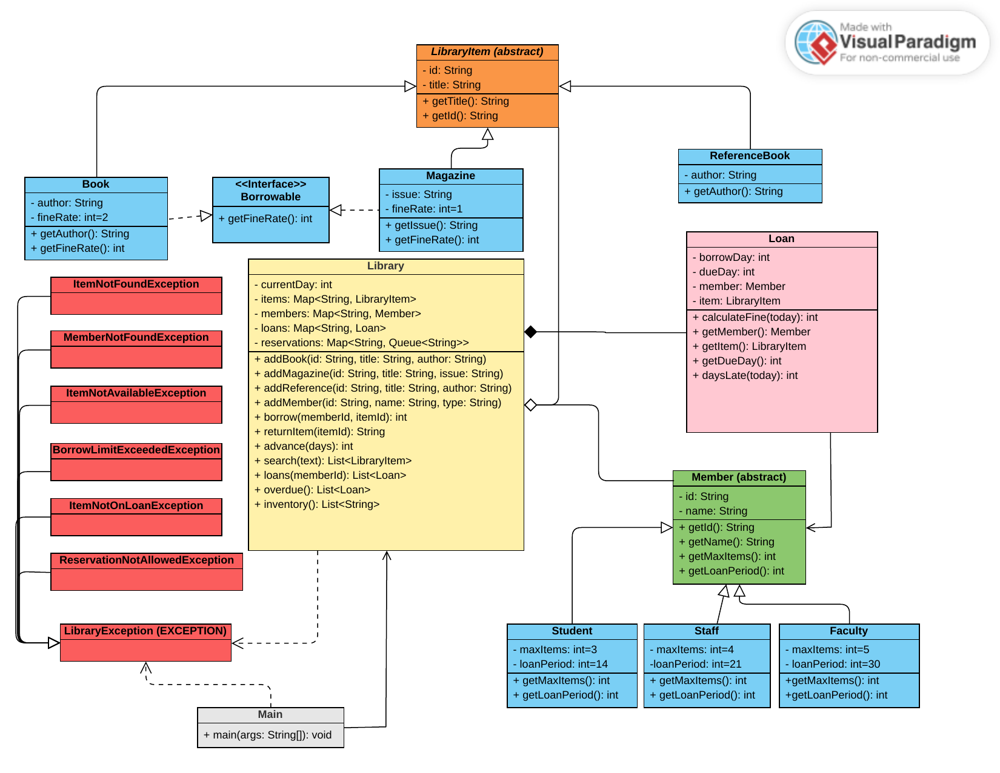

# 📚 Library Management System

A command-driven library system in Java that manages **items**, **members** and **loans**, with simulated time, fines, reports and reservations.


The program reads one command per line from standard input and prints the result of each command to standard output. Time starts at **day 0** and only moves forward with `ADVANCE`. The system clock is never used.

---

## Contents
- [Quick start](#-quick-start)
- [Class diagram](#-class-diagram)
- [Design: where each rule lives](#-design-where-each-rule-lives)
- [Commands](#-commands)
- [Errors](#-errors)
- [Testing](#-testing)
- [Project structure](#-project-structure)

---

## 🚀 Quick start

```bash
# Compile
javac -d out src/*.java

# Run a test script
java -cp out Main < tests/sample.txt

# Or type commands yourself (Ctrl+D to finish)
java -cp out Main
```

Example session:

```text
> ADD_BOOK|B1|Clean Code|Martin
OK
> ADD_MEMBER|S1|Aryan|STUDENT
OK
> BORROW|S1|B1
OK due on day 14
> ADVANCE|20
OK today is day 20
> RETURN|B1
OK fine 12
```

---

## 🧩 Class diagram



📄 [PDF version](docs/UML.pdf)

The code adds a few small things to the diagram above:

| Class | Addition | Why |
|---|---|---|
| `LibraryItem` | `getType()` (abstract) | Each item prints its own `BOOK` / `MAGAZINE` / `REFERENCE` label |
| `LibraryItem` | `isBorrowable()` | Returns `this instanceof Borrowable`, so the item decides whether it can be lent |
| `Library` | `reserve(memberId, itemId)` | Bonus `RESERVE` command, which uses the `reservations` map |
| `Library` | `getCurrentDay()`, private `findItem`, `findMember`, `isAtLimit` | The not-found and limit exceptions are thrown from these helpers |

---

## 🏛 Design: where each rule lives

| Rule | Lives in |
|---|---|
| Max items and loan period | `Student`, `Staff`, `Faculty` (`getMaxItems()`, `getLoanPeriod()`) |
| Whether an item can be borrowed | `Borrowable` interface, implemented only by `Book` and `Magazine` |
| Fine rate (₹2 / ₹1 per day) | `Book.getFineRate()`, `Magazine.getFineRate()` |
| Due day = borrow day + loan period | `Loan` constructor |
| Fine = days late × fine rate | `Loan.calculateFine(today)` |
| One member per item at a time | `Library.loans`, a map keyed by item ID |
| Catalogue, members, today's day | `Library` |
| Every error is caught in one place | `Main`'s command loop (`catch (LibraryException e)`) |

**Why `Loan` is its own class:** a loan has its own data (borrow day and due day) and its own behaviour (days late and fine). That data belongs to neither the member nor the item, so it gets its own class.

### Item types

| Type | Details | Borrowable | Fine per day late |
|---|---|:---:|---|
| `Book` | ID, title, author | ✅ | ₹2 |
| `Magazine` | ID, title, issue | ✅ | ₹1 |
| `ReferenceBook` | ID, title, author | ❌ | — |

### Member types

| Type | Max items at once | Loan period |
|---|:---:|---|
| `Student` | 3 | 14 days |
| `Staff` | 4 | 21 days |
| `Faculty` | 5 | 30 days |

---

## ⌨ Commands

Fields are separated by `|`, so titles and names may contain spaces.

| Command | Does | Output |
|---|---|---|
| `ADD_BOOK\|id\|title\|author` | Adds a book | `OK` |
| `ADD_MAGAZINE\|id\|title\|issue` | Adds a magazine | `OK` |
| `ADD_REFERENCE\|id\|title\|author` | Adds a reference book | `OK` |
| `ADD_MEMBER\|id\|name\|type` | Adds a `STUDENT`, `STAFF` or `FACULTY` member | `OK` |
| `BORROW\|memberId\|itemId` | Lends an item | `OK due on day <d>` |
| `RETURN\|itemId` | Takes an item back | `OK fine <amount>` |
| `ADVANCE\|days` | Moves time forward | `OK today is day <d>` |
| `RESERVE\|memberId\|itemId` | Joins the item's reservation queue *(bonus)* | `OK reserved` |

### Reports
Reports print one line per row, or `NONE` if there are no rows.

| Command | Each line | Sorted by |
|---|---|---|
| `SEARCH\|text` | `id\|TYPE\|title` | Title (case-insensitive match) |
| `LOANS\|memberId` | `itemId\|title\|dueDay` | Due day, then item ID |
| `OVERDUE` | `itemId\|memberId\|daysLate\|fine` | Most days late, then item ID |
| `INVENTORY` | `itemId\|TYPE\|status` | Item ID |

`status` is `AVAILABLE`, `ON_LOAN|memberId` or `NOT_BORROWABLE`.

### Reservations (bonus)
- An item can only be reserved while it is on loan.
- When a reserved item is returned, it goes to the first member in the queue who is below their limit. Members at their limit are skipped and stay in the queue. The output is then `OK fine <amount>, issued to <memberId> due on day <d>`.

---

## ⚠ Errors

Every failure is a custom exception that extends `LibraryException`. Each one is thrown where its rule is checked and caught once in `Main`, which prints `ERROR <message>`.

| Exception | Message |
|---|---|
| `ItemNotFoundException` | `item <id> not found` |
| `MemberNotFoundException` | `member <id> not found` |
| `ItemNotAvailableException` | `<id> is on loan` / `<id> cannot be borrowed` |
| `BorrowLimitExceededException` | `<memberId> has reached the limit of <max>` |
| `ItemNotOnLoanException` | `<id> is not on loan` |
| `ReservationNotAllowedException` | `<id> is available` / `<memberId> already has <id>` / `<memberId> already reserved <id>` |

---

## 🧪 Testing

Run every test:

```bash
./tests/run_tests.sh
```

Run one test by hand:

```bash
java -cp out Main < tests/sample.txt > out.txt
diff out.txt tests/sample_expected.txt     # no output means it passed
```

| Test | Covers |
|---|---|
| `sample` | The sample session from the brief |
| `errors` | One case for each error |
| `limits` | A Student, a Staff member and a Faculty member each reach their limit |
| `reserve` | Reservation rules and automatic issue on return |

---

## 📁 Project structure

```text
.
├── docs/
│   ├── UML.pdf            # Class diagram (original)
│   └── UML.png            # Same diagram, shown in this README
├── src/
│   ├── Main.java          # Command loop: parses input, prints output, catches errors
│   ├── Library.java       # Coordinator: items, members, loans, reservations, today's day
│   ├── Loan.java          # Member ↔ item link with due day and fine
│   ├── LibraryItem.java   # Abstract item
│   ├── Borrowable.java    # Interface for lendable items
│   ├── Book.java  Magazine.java  ReferenceBook.java
│   ├── Member.java        # Abstract member
│   ├── Student.java  Staff.java  Faculty.java
│   └── *Exception.java    # LibraryException and its 6 subclasses
└── tests/
    ├── run_tests.sh
    └── <name>.txt / <name>_expected.txt
```
